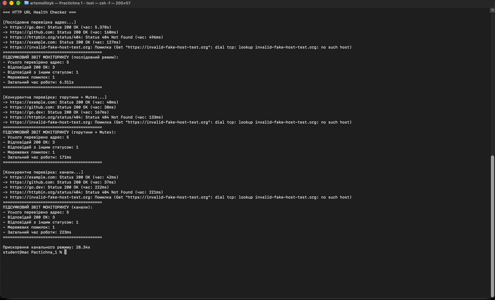
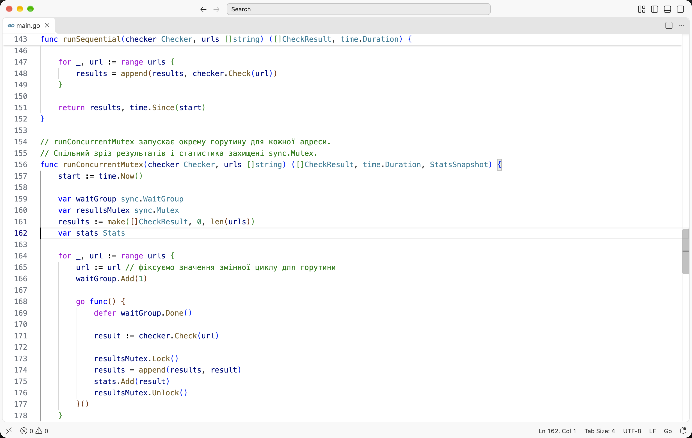
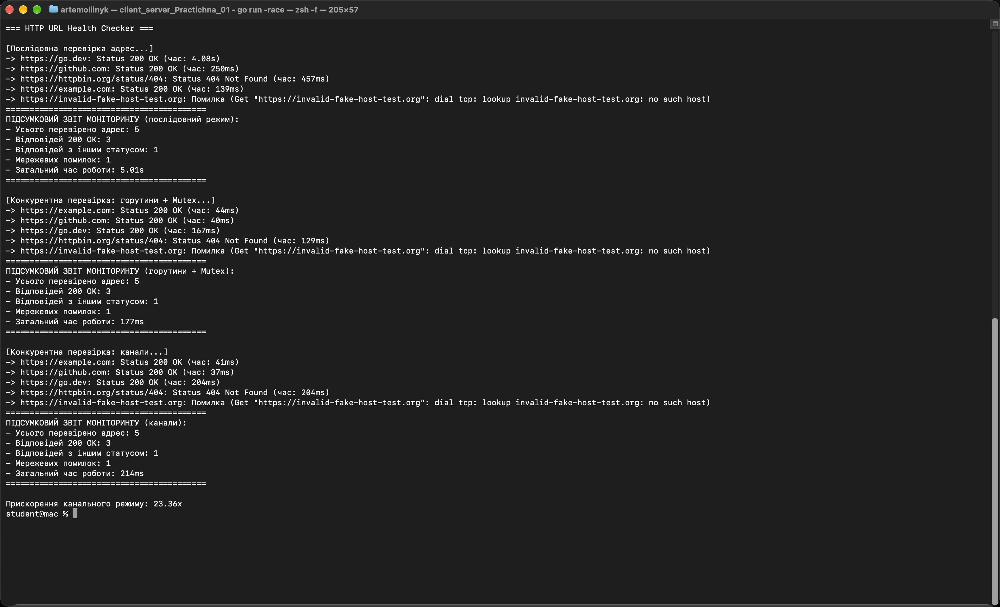
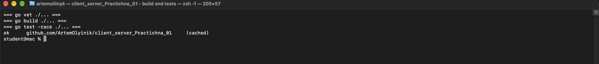
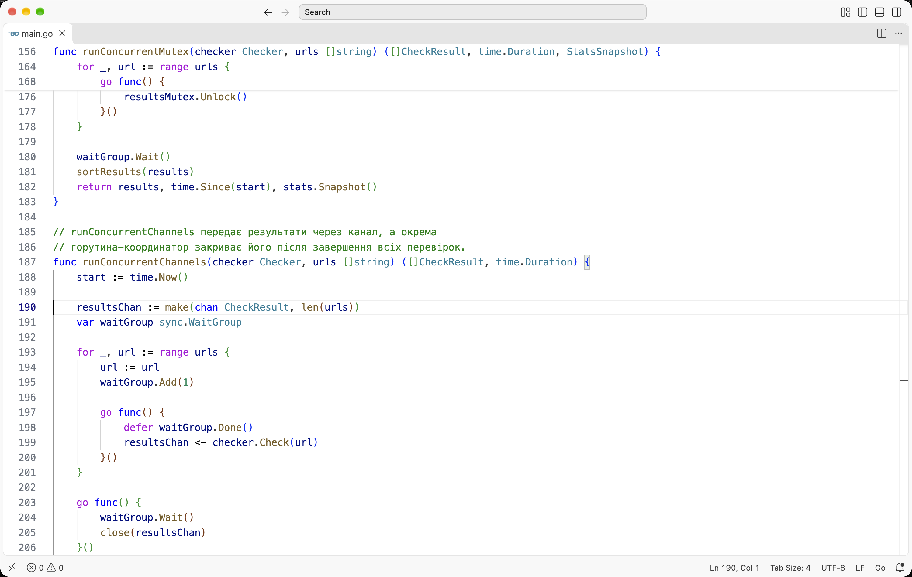

# Практична робота № 1. Базові конструкції, структури даних та конкурентність у Go

**Виконав:** Олійник Артем Сергійович  
**Курс:** IV  
**Група:** КН-43  
**Дисципліна:** Розробка застосувань клієнт-серверної архітектури  
**Викладач:** Олександр Олександрович Верещагін  
**Рік:** 2026

---

## Мета роботи

- Набути практичних навичок роботи з системою типів Go: структурами, методами з одержувачами та явним опрацюванням помилок.
- Опанувати проєктування інтерфейсів і неявну імплементацію.
- Засвоїти конкурентність CSP: горутини, `sync.WaitGroup`, `sync.Mutex`.
- Опанувати потокобезпечний обмін даними через канали та їх закриття.

---

## Середовище

| Компонент | Версія |
|---|---|
| Операційна система | macOS 27.0.1 |
| Go | 1.27.1 |
| Visual Studio Code | 1.145.2 |
| Git | 2.x |

Модуль проєкту: `github.com/ArtemOlyinik/client_server_Practichna_01`.

---

## Хід виконання

### Рівень 1. Базовий: структури, методи та послідовний моніторинг

#### 1. Ініціалізація проєкту

Створюємо робочу директорію, ініціалізуємо модуль і додаємо файл `main.go`:

```bash
go mod init github.com/ArtemOlyinik/client_server_Practichna_01
```

Структура проєкту:

```text
client_server_Practichna_01/
├── docs/                  # текст завдання
├── screenshots/           # скріншоти роботи
├── checker_test.go        # модульні тести
├── go.mod
├── main.go
└── README.md
```

#### 2. Моделювання результату перевірки

Для одного опитування описуємо структуру `CheckResult`:

```go
type CheckResult struct {
    URL        string
    StatusCode int
    Duration   time.Duration
    Err        error
}
```

Поля зберігають адресу, HTTP-статус, тривалість запиту та помилку з'єднання. Така структура передається між рівнями програми і не залежить від способу виконання перевірки.

#### 3. Інтерфейс і HTTP-обробник

Контракт перевірки описуємо інтерфейсом:

```go
type Checker interface {
    Check(url string) CheckResult
}
```

Реалізація `HTTPChecker` містить власний `http.Client` з таймаутом 8 секунд. У методі `Check` фіксуємо початок запиту через `time.Now()`, виконуємо `client.Get`, а після відповіді рахуємо `time.Since(start)`. Тіло відповіді дочитуємо в `io.Discard`, щоб звільнити з'єднання.

```go
start := time.Now()
response, err := c.client.Get(url)
result.Duration = time.Since(start)
```

#### 4. Послідовний прогін

У `main()` формуємо перелік із п'яти адрес: три реальні сайти, одна адреса зі статусом 404 і один неіснуючий домен. У циклі викликаємо `checker.Check` для кожної адреси та друкуємо статус, час і текст помилки.

Команда запуску:

```bash
go run .
```



*Рис. 1. Повний вивід програми: послідовний режим, режим із Mutex і режим із каналами.*

У послідовному режимі отримали 5 перевірок: три відповіді `200 OK`, одну `404 Not Found` і одну мережеву помилку для неіснуючого домену. Загальний час - 6.311 с. Найдовшим виявився перший запит до `https://go.dev` (5.378 с), решта запитів виконувалися швидше.

---

### Рівень 2. Конкурентний: горутини та захист спільного стану через Mutex

#### 1. Збереження функціональності Рівня 1

Послідовний режим залишається в програмі. Це дає змогу порівняти час виконання та перевірити, що конкурентна версія повертає ті самі результати.

#### 2. Розпаралелювання запитів

Для кожної адреси запускаємо окрему горутину. Значення `url` передаємо через локальну копію `url := url`, щоб усі горутини не використовували одну й ту саму змінну циклу:

```go
for _, url := range urls {
    url := url
    waitGroup.Add(1)

    go func() {
        defer waitGroup.Done()
        result := checker.Check(url)
        // ...
    }()
}
```



*Рис. 2. Фрагмент `main.go`: запуск горутин, `sync.WaitGroup` і критична секція з `sync.Mutex`.*

#### 3. Координація завершення горутин

Використовуємо `sync.WaitGroup`. Лічильник збільшуємо до запуску горутини через `Add(1)`, зменшуємо в самій горутині через `defer waitGroup.Done()`, а головний потік чекає на `waitGroup.Wait()`. Такий порядок не дає програмі завершитися раніше, ніж усі перевірки повернуть результат.

#### 4. Спільна статистика та усунення стану гонитви

Для підрахунку створюємо структуру `Stats` з полями `Total`, `OK200`, `HTTPError`, `NetError`. Оскільки горутини одночасно змінюють лічильники, доступ захищаємо `sync.Mutex`:

```go
func (s *Stats) Add(result CheckResult) {
    s.mu.Lock()
    defer s.mu.Unlock()
    // оновлення лічильників
}
```

Зріз результатів також захищений окремим `sync.Mutex`, бо `append` не є потокобезпечною операцією.

Перевіряємо програму детектором гонок:

```bash
go run -race .
```



*Рис. 3. Запуск `go run -race .`: програма відпрацювала повністю, попереджень `WARNING: DATA RACE` у консолі немає.*

Додатково запускаємо тести з детектором гонок і перевіряємо збірку:

```bash
go vet ./...
go build ./...
go test -race ./...
```



*Рис. 4. `go vet`, `go build` і `go test -race` завершилися без помилок, тестовий пакет повернув `ok`.*

У конкурентному режимі з Mutex загальний час становив 171 мс проти 6.311 с у послідовному режимі. Прискорення досягається за рахунок того, що запити до п'яти адрес виконуються одночасно, а не один за одним.

---

### Рівень 3. Просунутий: асинхронний збір результатів через канали

#### 1. Збереження функціональності попередніх рівнів

У програмі залишаються послідовний режим, режим із Mutex і режим із каналами. Усі три режими друкують однаковий набір адрес і підсумкову статистику.

#### 2. Передача результатів через канал

Створюємо буферизований канал результатів:

```go
resultsChan := make(chan CheckResult, len(urls))
```

Кожна горутина після перевірки надсилає структуру `CheckResult` у канал. Спільні лічильники в цьому режимі не використовуються, тому Mutex для статистики не потрібен.

#### 3. Життєвий цикл каналу

Окрема горутина-координатор чекає на завершення всіх перевірок і закриває канал:

```go
go func() {
    waitGroup.Wait()
    close(resultsChan)
}()
```

Закриття виконує саме координатор, а не робочі горутини. Це відповідає правилу: канал закриває той, хто надсилає дані, і лише після завершення всіх відправників.

#### 4. Обробка потоку результатів

Головний потік читає канал конструкцією `for result := range resultsChan`. Цикл завершується автоматично після закриття каналу. Після збору результатів сортуємо їх за URL і рахуємо статистику вже без блокувань.



*Рис. 5. Фрагмент `main.go`: канал результатів, горутина-координатор і цикл `for result := range resultsChan`.*

#### 5. Порівняльний аналіз продуктивності

За результатами контрольного запуску:

| Режим | Загальний час | Прискорення |
|---|---:|---:|
| Послідовний | 6.311 с | 1.00x |
| Горутини + Mutex | 171 мс | 36.91x |
| Канали | 223 мс | 28.34x |

Канальний режим трохи поступається режиму з Mutex через додаткові операції передачі даних і роботу координатора, але обидва конкурентні варіанти дають прискорення в десятки разів порівняно з послідовним опитуванням. Головний виграш дає одночасне виконання мережевих запитів, а не спосіб синхронізації.

---

## Інструкція запуску

```bash
# 1. Перейти в директорію проєкту
cd client_server_Practichna_01

# 2. Завантажити залежності
go mod download

# 3. Запустити програму
go run .

# 4. Перевірити відсутність гонок
go run -race .

# 5. Запустити тести та статичний аналіз
go test -race ./...
go vet ./...
go build ./...
```

Для роботи потрібен доступ до мережі Інтернет: програма опитує реальні сайти `https://go.dev`, `https://github.com`, `https://httpbin.org/status/404` і `https://example.com`. Адреса `https://invalid-fake-host-test.org` спеціально не існує, вона перевіряє обробку помилки DNS.

---

## Висновки

Під час виконання практичної роботи освоєно базові конструкції Go: структури, методи з одержувачами, інтерфейси та явне опрацювання помилок. Програма послідовно опитує п'ять адрес, потім виконує ті самі перевірки в окремих горутинах і збирає результати двома способами: через спільний стан із `sync.Mutex` та через канал із горутиною-координатором.

Порівняння показало, що конкурентний підхід скорочує загальний час із 6.311 с до 171-223 мс, тобто в десятки разів. Запуск `go run -race .` і `go test -race ./...` не виявив попереджень про гонки даних. Це підтверджує, що критичні секції захищені коректно, а канал закривається після завершення всіх відправників.

---

## Контрольні питання

1. **Чим неявна реалізація інтерфейсів у Go відрізняється від `implements` у Java чи C#?**  
   У Go тип не оголошує інтерфейс явно. Компілятор сам перевіряє, чи збігається набір методів типу з контрактом. Це зменшує зв'язність: один тип може задовольняти кілька інтерфейсів без зміни його оголошення. У Java і C# реалізація інтерфейсу вказується в оголошенні класу.

2. **Яка різниця між value receiver і pointer receiver?**  
   Value receiver отримує копію значення, тому не може змінити оригінальний об'єкт. Pointer receiver отримує адресу і може змінювати стан. Для великих структур pointer receiver ще й уникає копіювання. Методи з pointer receiver входять до методного набору покажчика, але не значення.

3. **Чому 1000 горутин не вичерпують пам'ять, а 1000 потоків ОС можуть?**  
   Горутина починається зі стека розміром 2-4 КБ, який динамічно росте й зменшується. Планувальник Go сам перемикає горутини на невеликій кількості потоків ОС. Потоки ОС зазвичай мають стек у кілька мегабайтів і плануються ядром, тому тисяча таких потоків створює значно більше навантаження на пам'ять і перемикання контексту.

4. **Що таке стан гонитви і як `-race` його виявляє?**  
   Стан гонитви виникає, коли дві горутини звертаються до однієї змінної одночасно, причому хоча б один доступ є записом, і немає синхронізації. Результат залежить від порядку виконання. Прапорець `-race` вмикає інструментальну перевірку доступу до пам'яті: вона фіксує конфліктні операції та виводить `WARNING: DATA RACE` зі стеками горутин.

5. **Для чого потрібен `sync.WaitGroup` і чому `Add()` викликають до `go`?**  
   `WaitGroup` чекає, поки завершиться група горутин. `Add(n)` збільшує лічильник, `Done()` зменшує, `Wait()` блокує до нуля. Якщо викликати `Add` після запуску горутини, головний потік може встигнути викликати `Wait` раніше й завершитися, або лічильник стане від'ємним. Тому `Add` виконують до `go`.

6. **Чим Mutex відрізняється від каналу?**  
   Mutex захищає спільну пам'ять: горутина бере блокування, змінює дані й відпускає його. Дані залишаються спільними. Канал передає значення від однієї горутини до іншої, синхронізуючи відправника й отримувача. Канали краще підходять для обміну повідомленнями та передачі володіння, Mutex - для захисту невеликих критичних секцій.

7. **Що буде при надсиланні в закритий канал або повторному закритті?**  
   Надсилання в закритий канал викликає паніку `send on closed channel`. Повторне закриття також викликає паніку `close of closed channel`. Читання із закритого каналу не блокує: воно одразу повертає нульове значення, а `v, ok := <-ch` дає `ok == false`. Тому закривати канал повинен лише відправник і лише після завершення всіх надсилань.
